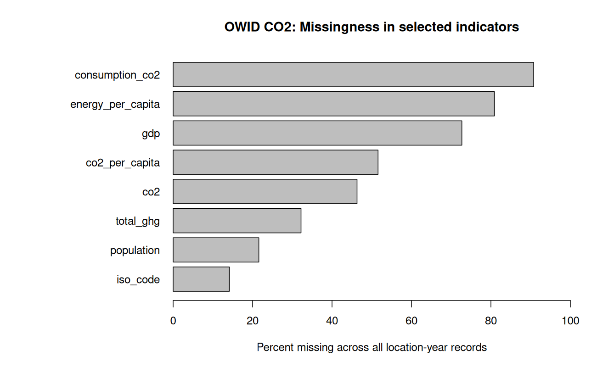
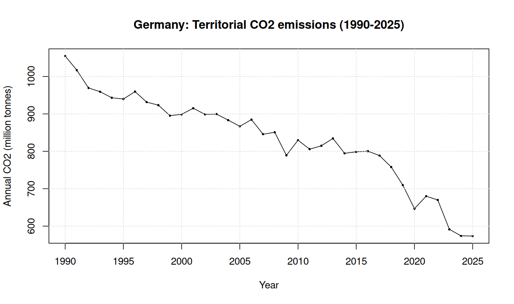
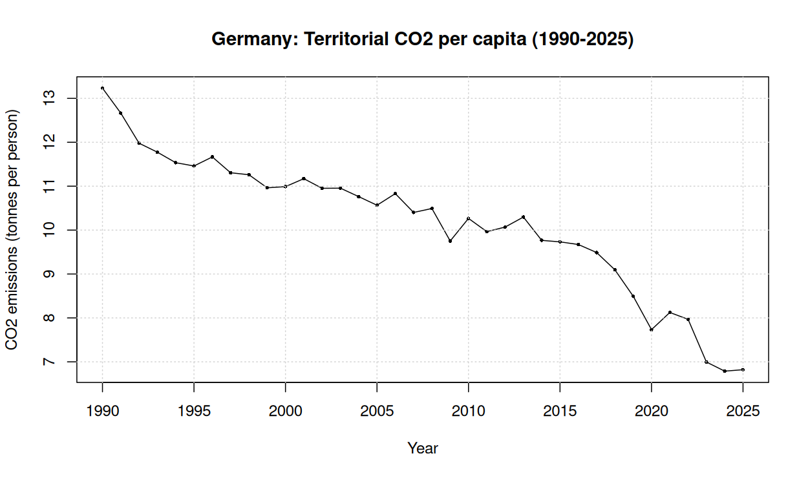

# GreenQuest | OWID CO₂ Exploratory Data Analysis (EDA)

**Jira:** GQUEST-13 · **Dataset:** OWID CO₂ data and codebook (2026 snapshot, includes 2025) · **Analysis date:** 20 November 2026 · **Status:** Initial dataset EDA

## 1. Purpose and scope

Evaluate the OWID country/region historical CO₂ series for GreenQuest environmental statistics. This dataset is **not** an individual lifestyle dataset and cannot, by itself, provide personalized challenges or activity-level carbon footprints. The UK 2026 GHG conversion-factor dataset must be analysed separately.

## 2. Data overview

| Metric | Observed value |
|---|---:|
| Rows | 56,269 |
| Columns | 79 |
| Geographic entities and aggregates (unique `country`) | 259 |
| Year span in the file | 1750–2025 |
| Exact duplicate (`country`, `year`) combinations | 0 |
| Codebook column definitions | 79 |
| Germany (`iso_code = DEU`) observations | 234 (1792–2025) |

The codebook and main file each specify the same 79 column names. Geographic entries include **aggregates/regions**, so 259 unique values must not be reported as 259 independent countries.

## 3. Data quality / missingness

| Indicator | Missing / total | Missing % | Codebook unit |
|---|---:|---:|---|
| `iso_code` | 7,963 / 56,269 | 14.15% | ISO code |
| `population` | 12,145 / 56,269 | 21.58% | people |
| `co2` | 26,050 / 56,269 | 46.30% | million tonnes (Mt) |
| `co2_per_capita` | 29,031 / 56,269 | 51.59% | tonnes/person |
| `gdp` | 40,902 / 56,269 | 72.69% | 2011 international-$ |
| `total_ghg` | 18,119 / 56,269 | 32.20% | million tonnes CO₂e (Mt CO₂e) |
| `consumption_co2` | 51,067 / 56,269 | 90.76% | million tonnes (Mt) |

Missingness across all historical location-year observations is **not** a fair estimate of modern coverage. Some measures begin much later than 1750. At least 36 different country labels have a missing ISO code, including continental/regional aggregates and World; not all missing ISO values are errors. Zero and missing are distinct and **must not** be conflated.

## 4. Germany time-series check

We selected `iso_code = DEU` and years 1990–2025 for a first GreenQuest dashboard subset.

| Year | `co2` (million tonnes) | `co2_per_capita` (tonnes/person) | `total_ghg` (Mt CO₂e) |
|---|---:|---:|---:|
| 1990 | 1054.796 | 13.233 | 1261.087 |
| 2000 | 898.974 | 10.990 | 1042.311 |
| 2010 | 829.787 | 10.266 | 944.315 |
| 2020 | 646.683 | 7.733 | 743.816 |
| 2024 | 573.925 | 6.788 | 659.655 |
| 2025 | 573.466 | 6.821 | missing |

Germany's territorial `co2` decreased **45.63%** between 1990 and 2025 in this particular file (1054.796 → 573.466 Mt). Per-capita `co2_per_capita` decreased **48.45%** over the same endpoints. These are descriptive trends; they are not causal estimates or individual carbon savings.

## 5. Descriptive statistics

The summary covers the 36 calendar years from 1990 through 2025. Statistics
use available annual observations, with sample standard deviation and
quartiles calculated by linear interpolation. Each row uses the indicator's
original units. Values are rounded to three decimal places.

| Indicator | Unit | Observed | Missing | First year | Last year |
|---|---|---:|---:|---:|---:|
| Territorial CO₂ | Mt CO₂ | 36 | 0 | 1990 | 2025 |
| Territorial CO₂ per capita | t CO₂/person | 36 | 0 | 1990 | 2025 |
| Total greenhouse gas emissions | Mt CO₂e | 35 | 1 | 1990 | 2024 |

| Indicator | Mean | Median | SD | Min | Q1 | Q3 | Max |
|---|---:|---:|---:|---:|---:|---:|---:|
| Territorial CO₂ | 833.288 | 848.339 | 121.045 | 573.466 | 789.074 | 917.315 | 1054.796 |
| CO₂ per capita | 10.166 | 10.447 | 1.579 | 6.788 | 9.626 | 11.194 | 13.233 |
| Total GHG | 974.134 | 978.997 | 147.009 | 659.655 | 905.751 | 1065.910 | 1261.087 |

Mt denotes million tonnes, t denotes tonnes, and CO₂e denotes carbon dioxide
equivalent. Q1 and Q3 are the 25th and 75th percentiles. Germany's lowest
territorial CO₂ total in the period was 573.466 Mt in 2025. The lowest
per-capita value was 6.788 t CO₂/person in 2024, followed by a small rise in
2025. Total greenhouse gas emissions averaged 974.134 Mt CO₂e over
1990–2024. The source series ends in 2024, so the missing 2025 observation
was excluded from those statistics.

## 6. GreenQuest feature mapping

| Feature | Potential OWID data | Use |
|---|---|---|
| Environmental statistics dashboard | `country`, `iso_code`, `year`, `co2` | Historical national emissions trends |
| Per-capita awareness chart | `co2_per_capita` | National emissions-per-person benchmark; **not** user footprint |
| Context/background | `population`, selected other series | Compare/label time-series with units |
| Personal carbon calculator | **Not supported directly** | Use separate location- and activity-appropriate emission factors |
| Personalized ML model | **Not supported directly** | Need labeled user-level interaction or preference data |

## 7. Limitations and decisions

1. Treat regional/World aggregates separately from countries. Do not add the World figure to the sum of country figures.
2. Report units explicitly: `co2` is **million tonnes CO₂**, while `co2_per_capita` is **tonnes per person**. Both differ from activity-level kg CO₂e.
3. Missing values cannot be replaced with zero without justification; particularly note 2025 `total_ghg` missing in the Germany row.
4. The 2025 observations and codebook reference Global Carbon Budget (2026); source data can be revised. The dataset documentation records the snapshot and SHA-256 checksums for reproducibility.
5. Do not merge the OWID historical location-year file row-for-row with the UK GHG conversion-factor file. These datasets describe different entities.
6. Descriptive correlation/trend analysis is not a claim that individual users reduced emissions or that a recommendation model is accurate.

## 8. Next action

Review the EDA results with the team. Then preprocess a minimal verified statistics table for the app, keeping indicator and unit metadata. Perform a separate EDA for the UK GHG factors before building the activity calculator. A user-level dataset is still needed for experimental ML recommendations.

## Data sources

- Input files: `owid-co2-data.csv` and `owid-co2-codebook.csv`.
- Upstream project: <https://github.com/owid/co2-data>.
- Source descriptions and units: supplied OWID codebook (many indicators trace to the Global Carbon Budget and other producers).

*Reproducibility note: Run `01_owid_eda.R` from the repository root with the checksum-verified inputs to reproduce the five CSV outputs and three figures.*
